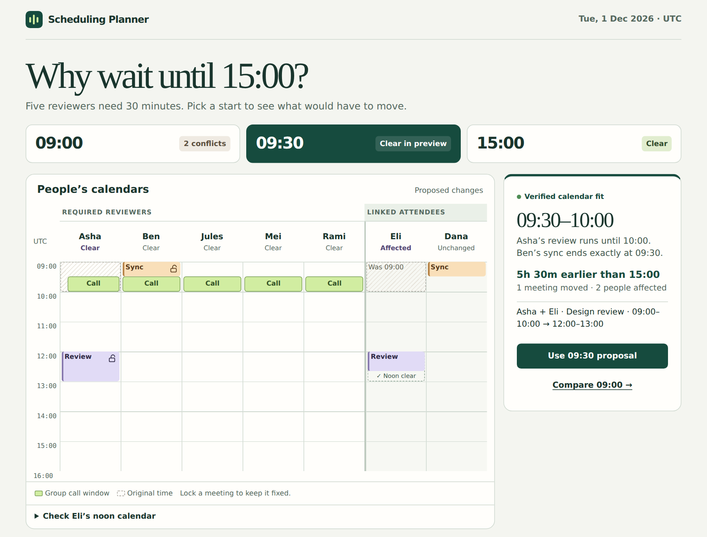

# Scheduling Planner

**Find a group meeting time and show what it would take to meet earlier.** The `plan-meetings` agent skill gathers dated calendar evidence. A local Python solver checks each placement, including the calendars of people whose meetings would have to move.



## Try the decision

Five reviewers need half an hour on Tuesday, 1 December 2026. **Moving one meeting buys 5½ hours. Moving a second buys just 30 minutes more.** The first change needs agreement from Asha and Eli, even though Eli is outside the group call.

From a downloaded checkout, open [the interactive calendar](docs/demo.html) in your browser, or run the launcher. On Windows, use `py run.py --browser`.

```sh
python3 run.py --browser
```

1. Select **09:30** and preview the design review moving to noon. Watch Asha’s and Eli’s calendars change together.
2. Compare **09:00** to see the extra move. Lock the review or remove Eli’s noon coverage to see how the answer changes.
3. Choose a proposal. Save the text to discuss with the group, or download the JSON snapshot and check that start with the solver. The demo runs offline using synthetic calendars.

```sh
uv run --locked schedule-plan snapshot.json --brief --ranking earliest
```

## Plan a squad week

The synthetic squad example places two 1:1s for a Dubai-based lead and colleagues in Dubai and Riyadh. Each calendar declares its own working hours, weekend and observed coverage. From the checkout, run these commands after installing the project, or prefix each `schedule-plan` command with `uv run --locked`.

```sh
schedule-plan batch-snapshot examples/squad-week-batch.json > snapshot.json
schedule-plan calendar-os snapshot.json
schedule-plan portfolio snapshot.json --compare-moves > decision.json
schedule-plan export-pack decision.json --snapshot snapshot.json --output squad-proposal
```

Open `squad-proposal/plan.html` to compare the current week with the proposal. The pack also contains the source snapshot and a plain-language proposal. Anyone receiving it can read that calendar evidence, including titles and attendee names. For a standalone view of an existing single-meeting brief, run:

```sh
schedule-plan --demo > brief.json
schedule-plan visualize brief.json --output proposal.html
```

See the [portfolio and calendar input guide](docs/portfolio.md) for data formats and proof scope, and the [organizer apply workflow](docs/apply.md) to prepare and approve calendar changes.

## Give the skill to an agent

1. Open the **whole checkout** in an agent host that discovers repository skills. The entry point is [plan-meetings](.agents/skills/plan-meetings/SKILL.md). In hosts with a skill picker, select it or invoke `$plan-meetings`. In another host, supply that file as the agent's instructions and make the checkout or installed CLI available to its execution tool.
2. Give the agent dated availability, or access to an authorized source that can provide it. State the attendees, duration, time zone, and which appointments it may consider moving. The host supplies the calendar-reading capability. The planner itself operates on a local snapshot.
3. Try the following prompt against the bundled fixture. It requires no access to real calendars.

> Use $plan-meetings with `src/scheduling_planner/data/demo.json`. Find 30 minutes for the five reviewers on 1 December. Compare waiting with moving one or two meetings. Give the exact gain, say who else would need to agree, and recommend which change is worth requesting. Return a proposal in UTC.

For an integration with an authorized Python reader, use the [reference workflow and host evaluations](docs/workflow-evaluations.md). It returns the recommendation and a trace of reads, clarifications, solves and proof claims. Use the checkout or source distribution for the skill, examples and evaluations. The wheel supplies the Python tools.

## Run the same case from a terminal

Install [uv](https://docs.astral.sh/uv/getting-started/installation/) and open a terminal in the checkout. The same command works in PowerShell and a POSIX shell.

```sh
uv run --locked schedule-plan --demo
```

The first run obtains a compatible CPython if needed, installs the locked packages in the checkout's `.venv`, and runs the native solver. After setup, use `uv run --offline --locked schedule-plan --demo` to run disconnected. For a first install without internet, prepare a [matching wheelhouse](docs/releasing.md#prepare-a-checkout-for-offline-use).

With Python already installed, the compatibility command is `python3 run.py --demo` or `py run.py --demo` on Windows. On supported CPython, `python3 run.py --help`, `--version` and the schema flags work directly from source before installing solver packages. A Python 3.9 or 3.10 launcher with pip can obtain uv and CPython 3.12 on its first connected run.

In the JSON response, inspect `move_comparison.caps`. The expected rows for the original demo are:

| Permitted moves | Earliest verified start (UTC) | Time gained over previous option |
|---:|---:|---:|
| 0 | 15:00 | Baseline |
| 1 | 09:30 | 330 minutes |
| 2 | 09:00 | 30 minutes |

The comparison answers an **earliest-time** question at each move limit. The default preferred ranking prioritizes avoiding disruption, so its primary option can still be 15:00. Each option carries the proof for the ranking and scope that produced it.

### Native solver compatibility

Use standard 64-bit CPython 3.11–3.14. The native OR-Tools wheel determines which environments can run a solve.

| Platform | Installation requirement |
|---|---|
| macOS | Intel x86-64 or Apple Silicon arm64, using a wheel compatible with the installed macOS version. |
| Windows | x86-64 CPython and the Microsoft Visual C++ 2022 x64 Redistributable. Native Windows ARM64 Python lacks a matching solver wheel. |
| Linux | x86-64 or ARM64 with glibc compatible with the published wheels. For containers, use a modern Debian or Ubuntu base. Alpine's default musl environment lacks a matching solver wheel. |

For a “no matching distribution” error, check the Python minor version, architecture, libc and configured package source. For a Windows DLL-load error, check the x64 runtime. The CI configuration exercises Ubuntu x64 on Python 3.11–3.14, macOS arm64 on 3.13 and Windows x64 on 3.12. Other entries above describe available binaries. [OR-Tools wheels](https://pypi.org/project/ortools/9.15.6755/#files) · [Windows prerequisite](https://developers.google.com/optimization/install/python/pkg_windows)

## Connect the Python tools

| Agent task | Command from the checkout |
|---|---|
| Inspect the input contract | `uv run --locked schedule-plan --schema` |
| Read a private snapshot from stdin and compare move limits | `uv run --locked schedule-plan - --brief --compare-moves` |
| Inspect full advice and proofs for the conditional fixture | `uv run --locked schedule-plan sample.json --advise` |
| Validate the team's preference profile | `uv run --locked schedule-plan --show-profile --profile examples/team-profile.json` |
| Read the contract for a brief response | `uv run --locked schedule-plan --brief-schema` |

For new snapshots use `schema_version: "1.1"`. Capture working eligibility in `available`, the periods actually checked for commitments in `busy_coverage`, and each existing occurrence in `events`. A person's working hours alone cannot establish that they're free. Include the rest buffer on either side of a proposed appointment when collecting coverage.

The CLI writes JSON to stdout and diagnostics to stderr. From a Python host with the package installed, the equivalent for a compact decision is:

```python
import json
from pathlib import Path
from scheduling_planner import advise, brief

snapshot = json.loads(Path("sample.json").read_text(encoding="utf-8"))
decision = brief(advise(snapshot, compare_moves=True))
primary = next((o for o in decision["options"] if o["id"] == decision["primary_id"]), None)
if primary:
    print(primary["start"], primary["moves"])
print(decision["status"], decision["questions"])
```

On the [conditional fixture](sample.json), waiting gives Wednesday at 14:00 Dubai time. Moving Bob and Eli's sync gives Tuesday at 11:00. A further option at 10:00 depends on Dana's availability for a replacement review. An agent should give the organizer the verified choice alongside the specific question that could improve it.

## Install the CLI and Python library

From the repository root with a supported CPython 3.11–3.14 interpreter:

```sh
python3 -m venv .venv
. .venv/bin/activate
python -m pip install -e .
schedule-plan --demo
```

On Windows PowerShell with Python 3.12, create the environment using `py -3.12 -m venv .venv` and activate it with `.venv\Scripts\Activate.ps1`. After installation, `schedule-plan` and `python -m scheduling_planner` accept the same solver arguments as the checkout launcher.

## Go deeper

| If you want to… | Start here |
|---|---|
| Change how the agent gathers evidence or explains tradeoffs | [Agent instructions](.agents/skills/plan-meetings/SKILL.md) · [Solver playbook](.agents/skills/plan-meetings/references/solver-playbook.md) |
| Set team priorities or add a post-solve annotation | [Preferences and hooks](docs/preferences.md) · [Example profile](examples/team-profile.json) |
| Model a deadline, staffing rule, or room capacity | [Rule-authoring guide](docs/writing-rules.md) · [Team rule implementations](examples/team_rules.py) |
| Understand eligibility, rest, objectives, and compatibility | [Scheduling model](docs/model.md) |
| Decide what “verified”, “optimal”, or a time limit allows you to claim | [Proofs and result interpretation](docs/proofs.md) |
| Test an agent adapter or measure solver performance | [Workflow evaluations](docs/workflow-evaluations.md) · [Benchmark](docs/benchmark.md) |
| Contribute a change or build a release | [Contributing](CONTRIBUTING.md) · [Release checks](docs/releasing.md) · [Changelog](CHANGELOG.md) |

[Apache License 2.0](LICENSE) · [Security reporting](SECURITY.md)
